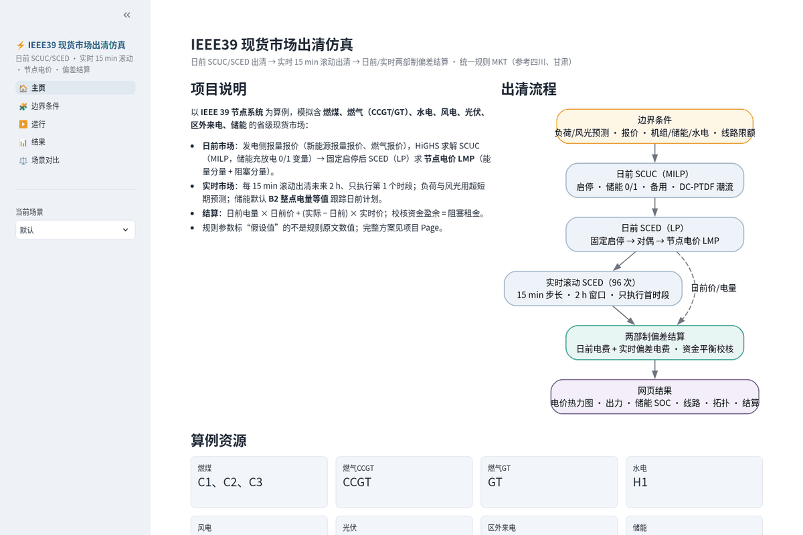
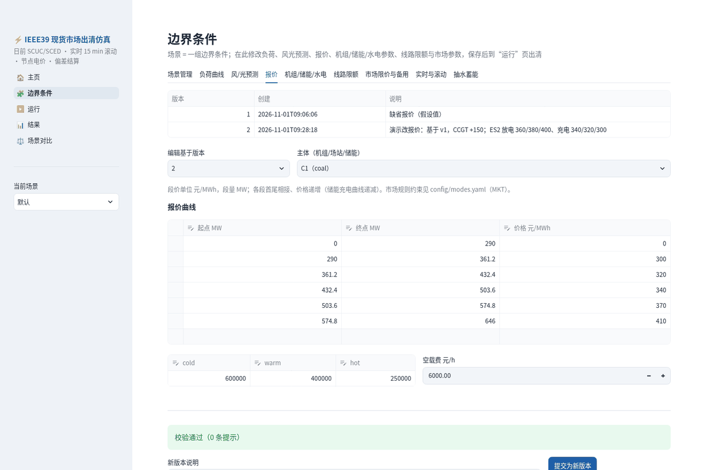
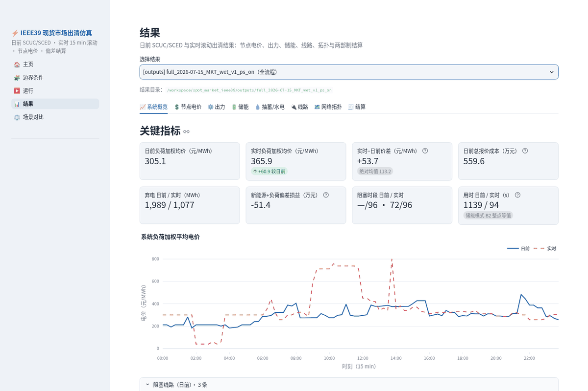
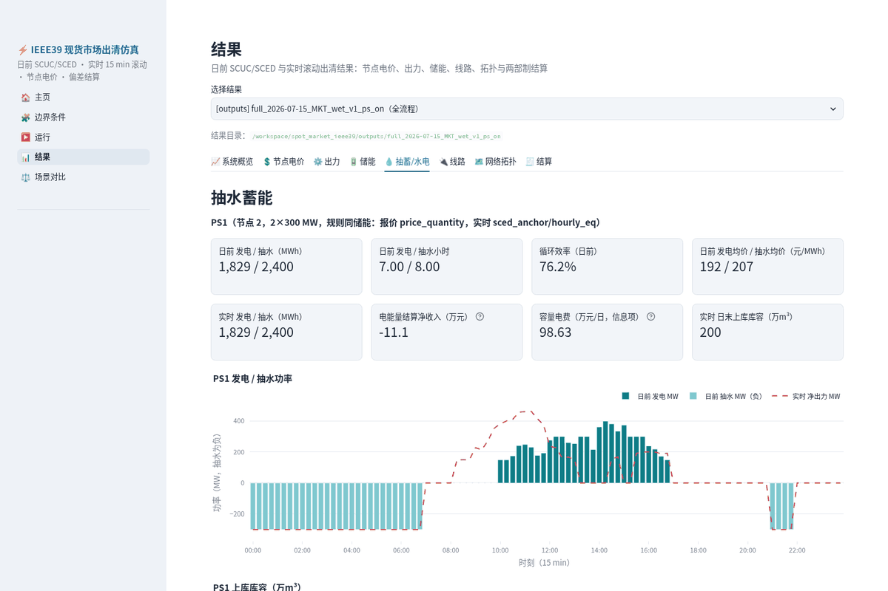

# IEEE39 电力现货市场出清仿真

在改造的 IEEE 39 节点系统上模拟一个完整的电力现货市场：**日前 SCUC/SCED 出清节点电价 → 实时 15 分钟滚动 SCED → 日前/实时两级偏差结算**。可以改报价、改边界条件，在网页里运行和看结果。

- 完整的建模方案、公式和规则出处见 [docs/仿真方案.md](docs/仿真方案.md)
- 开发过程、参数依据、求解提速试验和对比算例数据见 [docs/开发记录.md](docs/开发记录.md)

> 规则参数参考四川（川V4.0）、甘肃（甘V3.2）现货规则，统一成一套自有规则 `MKT`，逐项在 `config/modes.yaml` 注明出处。标“假设值”的数值不是规则原文给出的，只用于让算例可解、有代表性。

## 功能

| 功能 | 说明 |
|---|---|
| 日前 SCUC / SCED | 96 点（15 min）MILP 机组组合：火电启停、储能充放 0-1、水电开机台数、抽蓄工况；固定整数后 LP 重解，取对偶得到节点电价 |
| 节点电价 LMP | 直流潮流 PTDF，LMP = 能量价 λ + 阻塞分量，每次运行自动核对分解；限价 [0, 800] 元/MWh |
| 实时滚动 | 每 15 min 出清未来 2 h、只执行首时段（甘肃模式）；燃煤/CCGT 启停锁定日前，燃气 GT 可启停；默认不设独立日内市场（`--intraday` 可开） |
| 多类资源 | 燃煤×3、燃气（CCGT、GT）、风×2、光伏、水电（库容型/径流式）、储能×3、抽水蓄能 PS1、区外联络线 |
| 储能 / 抽蓄 | 分段报价、SOC/库容动态、期末申报；实时三种模式：B2 整点锚定（默认）/ B1 窗口末 ±x / A 执行日前；抽蓄规则与储能相同 |
| 预测误差 | 日前、超短期预测按 AR(1) 误差生成，随提前量收敛；实时首时段用实际值 |
| 两级结算 | 日前量 × 日前价 + 偏差量 × 实时价，按主体、类型输出；对账（阻塞盈余）残差约 1e-9 元 |
| 报价管理 | 报价按版本保存（v1、v2…），提交前按规则校验（段数、递增、步长、限价等），违规不能保存 |
| 网页应用 | Streamlit 中文界面：场景管理、边界条件编辑、后台运行、结果图表、场景对比 |

## 目录结构

```
config/            参数配置
  base.yaml          运行参数：日期、季节、负荷缩放、线路压缩、求解器
  units.yaml         机组参数：火电、联络线、风光、水电、抽蓄、储能
  modes.yaml         市场规则 MKT：限价、报价分段、备用、罚因子、日内/实时、抽蓄规则
data/
  case39/            IEEE39 母线、支路（由 scripts/export_case39.py 从 pandapower 导出）
  profiles/          96 点负荷、风、光的日前预测与“实际”曲线
bids/{date}/MKT/   报价版本 bids_v{n}.json（以 JSON 为准）与 bids_v{n}.csv（便于查看）
src/smm/           模型代码
  network.py         PTDF                  forecast.py    预测与误差
  bids.py            报价生成/校验/存取     case.py        日前算例、备用需求
  scuc.py            Pyomo MILP/LP、对偶取价 da.py          日前流程
  rolling.py         实时滚动 SCED、储能锚点 settlement.py 两级结算、对账
  full.py            全流程、校核、输出      scenario.py    场景与运行目录管理
scripts/           命令行入口：main_full.py、main_da.py、run_scenario.py、run_app.sh 等
app/               网页应用：主页.py、pages/1_边界条件.py、2_运行.py、3_结果.py、4_场景对比.py
tests/             pytest 测试
docs/              仿真方案.md、开发记录.md、images/
outputs/  runs/  scenarios/   运行结果与本地场景（自动生成，不入库）
```

## 环境与安装

- Python **3.11 及以上**（开发和测试环境为 Python 3.13.5，Linux）
- 求解器 HiGHS 通过 `highspy` 包安装，不需要另装求解器
- 建议 4 核以上 CPU、4 GB 以上内存；一次全天全流程约 10–12 分钟（主要是含抽蓄的日前 SCUC，按 600 s 时限求解）

```bash
git clone https://github.com/stardustwlshen/spot_market_ieee39.git
cd spot_market_ieee39
python3 -m venv .venv
. .venv/bin/activate              # Windows：.venv\Scripts\activate
pip install -r requirements.txt
```

`requirements.txt` 中的版本是开发环境的实测版本（pyomo 6.10.1、highspy 1.15.1、streamlit 1.66.1、plotly 7.1.0 等）。

## 快速开始

### 方式一：网页应用

```bash
bash scripts/run_app.sh            # 后台启动，默认只监听 127.0.0.1:8501
```

然后在浏览器打开 <http://localhost:8501>。

```bash
bash scripts/run_app.sh restart    # 改代码后重启
bash scripts/run_app.sh stop       # 停止
PORT=8600 bash scripts/run_app.sh  # 换端口
```

- 进程号在 `outputs/app.pid`，日志在 `outputs/app.log`；健康检查 `curl http://127.0.0.1:8501/_stcore/health`。
- `run_app.sh` 需要先建好 `.venv`（见上节），并使用 `curl` 等待启动完成。
- 脚本默认设置 `TZ=America/Los_Angeles`，运行目录名和日志时间按该时区；可在启动前设置 `TZ` 覆盖。
- 应用**没有登录鉴权**，默认只监听本机。在远程服务器上运行时，请用 SSH 端口转发访问（`ssh -L 8501:127.0.0.1:8501 <服务器>`），不要直接暴露到公网。
- 不想后台运行时，也可以直接 `streamlit run app/主页.py`。

### 方式二：命令行

```bash
. .venv/bin/activate

# 全流程：日前 → 实时 96 个时段滚动 → 结算（最新报价版本，约 10–12 分钟）
python scripts/main_full.py

# 快速检查：日前 + 只滚动前 8 个时段，不出图（约 10 分钟，几乎全是日前 SCUC）
python scripts/main_full.py --periods 8 --no-plots

# 指定报价版本；切换储能实时模式（结果目录加后缀以免覆盖）
python scripts/main_full.py --bid-version 1
python scripts/main_full.py --anchor window_end_pct --anchor-x 0.05 --tag _b1   # B1：窗口末 ±x
python scripts/main_full.py --storage-mode fixed_da --tag _fixed_da            # A：执行日前曲线
python scripts/main_full.py --rt-lookahead-h 1 --intraday                       # 改前瞻时长、打开独立日内

# 只做日前出清（约 10 分钟）；--time-limit 缩短 MIP 时限可更快拿到可行解（gap 会变大）
python scripts/main_da.py
python scripts/main_da.py --season dry --time-limit 120 --no-plots

# 按网页里保存的场景运行
python scripts/run_scenario.py --scenario 默认 --mode full --periods 8
```

| 参数 | 脚本 | 说明 |
|---|---|---|
| `--bid-version N` | main_full / main_da / run_scenario | 报价版本，缺省用最新版本 |
| `--season wet\|dry` | main_full / main_da | 丰水期 / 枯水期，缺省见 `base.yaml` |
| `--periods N` | main_full / run_scenario | 实时只滚动前 N 个时段（调试用，缺省 96） |
| `--time-limit S` | main_da | 日前 MIP 时限（秒） |
| `--storage-mode sced_anchor\|fixed_da` | main_full | 储能、抽蓄实时模式 |
| `--anchor hourly_eq\|window_end_pct`、`--anchor-x` | main_full | 锚点方式（B2 / B1）和 B1 的浮动比例 |
| `--rt-lookahead-h H` | main_full | 实时前瞻时长，缺省 2 h |
| `--intraday`、`--id-interval-h H` | main_full | 打开独立日内滚动及其周期 |
| `--no-plots` | main_full / main_da | 不输出 PNG 图 |
| `--tag _xxx` | main_full | 输出目录后缀 |

参考用时（4 线程，2026-07-15 丰水期）：含抽蓄 PS1 后日前 MIP 较难，通常跑满 `config/base.yaml` 中 `solver.time_limit_s`（默认 600 s），取时限内最优可行解（gap 约 1%）；实时 96 个时段约 1–1.5 分钟；全流程约 10–12 分钟（2026-11-02 实测：报价 v2、`--periods 4` 合计 609 s，其中日前 606 s）。机器繁忙时会更慢。想更快试跑，可把 `solver.time_limit_s` 调小（如 120），代价是 gap 变大；不含抽蓄（`config/units.yaml` 中 PS1 `enabled: false`）时日前约 2 分钟、全流程约 3 分钟。

其他脚本：`demo_rebid.py`（改报价演示：违规被拒 → 修正提交新版本 → 改前改后对比）、`make_default_bids.py`（重新生成默认报价 v1）、`compare_pumped.py`（有/无抽蓄对比）、`bench_scuc.py`（求解参数对比）。

## 网页使用指南

左侧导航有 5 个页面，右上角的“当前场景”决定编辑和运行哪一套边界条件。



1. **主页**：项目说明、出清流程、算例资源、最新结果速览。
2. **边界条件**：一个“场景”就是一套完整的边界条件，修改后自动保存在 `scenarios/<场景名>/`。共 9 个标签页：
   - **场景管理**：新建、复制、删除场景，写备注（“默认”场景不能删除）；
   - **负荷曲线**：负荷缩放、季节、随机种子；96 点表格编辑或上传 CSV；
   - **风/光预测**：各阶段误差 σ、自相关 φ；96 点实际或日前预测覆盖；
   - **报价**：选择基于哪个版本、哪个主体，编辑段价段量、储能充放电段与期末 SOC、启动/空载费；页面实时校验，**有错误时不能提交**；提交后另存为新版本 vN+1，旧版本保留；
   - **机组/储能/水电**：火电、风光、联络线参数，储能容量/效率/SOC，水电来水与库容、库容型/径流式切换；
   - **线路限额**、**市场限价与备用**、**实时与滚动**（储能模式 B2/B1/A、x、前瞻时长、日内开关、求解器参数）、**抽水蓄能**（物理参数；市场规则同储能）。

   

3. **运行**：选择模式（仅日前 / 全流程）、报价版本、调试时段数，点“开始运行”。运行在后台进行，页面每 2 秒刷新进度和日志，可以随时停止。结果保存在 `runs/<场景名>/<时间戳>_<da|full>/`。
4. **结果**：选择一次运行（也会列出命令行生成的 `outputs/` 结果），9 个主标签页：系统概览、节点电价（热力图、节点曲线、日前/实时/差值）、出力堆叠、储能（SOC 与锚点）、抽蓄/水电、线路负载率、网络拓扑着色、结算（按类型/主体/对账/明细，可下载 CSV），以及主体/SCUC-SCED阶段诊断与完整整数导出。水电页区分已执行V/P与前瞻窗口末软目标及偏差。

   
   

5. **场景对比**：任选两个结果，对比指标（A / B / B−A）、负荷加权价曲线、节点均价、分类型电量；两者都是全流程时再对比结算。

## 配置说明

所有参数都在 `config/` 下（网页修改的是场景目录里的副本，不影响仓库里的默认配置）。

**`config/base.yaml`（运行参数）**

| 字段 | 默认 | 说明 |
|---|---|---|
| `date` / `season` | 2026-07-15 / wet | 运行日；丰水期 wet、枯水期 dry |
| `load_scale` | 0.68 | 负荷缩放（假设值） |
| `line_scale` | 5 条线 0.5–0.7 | 线路限额压缩系数，用于制造阻塞 |
| `solver.mip_rel_gap` / `time_limit_s` / `threads` | 0.002 / 600 / 4 | 日前 MIP 参数 |
| `solver.commit_step_periods` | 1 | 设 4 表示火电按小时启停，约快一半、成本 +0.4% |
| `solver.highs_extra` | {} | 透传其他 HiGHS 参数 |

**`config/units.yaml`（资源参数，均为假设值）**

- `thermal`：`pmax/pmin`、爬坡 `ramp`（MW/min）、最小开停机 `ut/dt`、启动费 `startup`、初始状态 `init`。
- `renewable`：装机 `cap`、曲线 `profile`；`tie`：联络线固定计划。
- `hydro`：`regulation`（`reservoir` 库容型 / `run_of_river` 径流式）、台数与振动区 `zones`、耗水率、`seasons`（来水、库容上下限、期末库容、生态流量、日电量）。
- `pumped`：`enabled`、`bus`、台数与单机功率、转换系数 `e_gen/e_pump`、上下库容、`vup_end_bid`、启动次数上限。
- `storage`：`pmax`、`ecap`、效率、SOC 上下限、初值 `soc0`、申报期末 `soc_end_bid`。

**`config/modes.yaml`（市场规则 `MKT`，逐项注明出处）**

- `price_limits`：申报、出清上下限；`segments`、`price_step`、`min_seg_frac`、`max_adjacent_step`：报价校验规则。
- `reserve`：备用系数 `rho_*`、N-1、`providers`、`storage_reserve`。
- `penalties`：正式SCUC/SCED调度罚；`auxiliary_pricing`：独立辅助模型三罚及出力带。当前两阶段数量/价格分别标记，不复用旧`pricing_penalties`键。
- `intraday`：独立日内（默认关闭）；`realtime`：周期、前瞻、锁定类型、水电和储能实时处理。
- `pumped`：抽蓄规则（`rules: storage`）。

**报价文件 `bids/{date}/MKT/bids_v{n}.json`**

```json
{
  "date": "2026-07-15", "rule_set": "MKT", "version": 1, "note": "缺省报价（假设值）",
  "units": {
    "C1":  {"mode": "price_quantity",
            "segments": [{"p_start": 0, "p_end": 290, "price": 0}, {"p_start": 290, "p_end": 361.2, "price": 300}, "..."],
            "startup_cost": {"cold": 600000, "warm": 400000, "hot": 250000}},
    "W1":  {"mode": "price_quantity", "segments": ["..."], "avail_pmax": null},
    "ES1": {"mode": "price_quantity", "dis_segments": ["..."], "ch_segments": ["..."],
            "soc_min": 0.1, "soc_max": 0.9, "soc_end": 0.5}
  }
}
```

- 段为 `[p_start, p_end]`（MW）和 `price`（元/MWh），首尾相接、价格递增（储能充电段递减）。
- 储能 `soc_end` 为申报期末 SOC（硬约束），`null` 表示不申报。报价中没有的主体（如 PS1）按 `src/smm/bids.py` 的缺省报价补齐。
- 建议通过网页“报价”页或 `scripts/demo_rebid.py` 的方式生成新版本，这样会先经过 `validate_bids` 校验；手工新建 `bids_v{n+1}.json` 时，同目录的 CSV 仅供查看。

## 输出文件

命令行结果在 `outputs/`，网页运行在 `runs/<场景名>/<时间戳>_<da|full>/`（另含 `meta.json`、`run.log`、`scenario_snapshot/`）。

| 目录 / 文件 | 内容 |
|---|---|
| `outputs/da_{date}_MKT_{season}_v{n}/` | 仅日前结果 |
| `outputs/full_{date}_MKT_{season}_v{n}{tag}/` | 全流程结果（含主要日前文件 `da_unit_awards/da_nodal_prices/da_storage.csv`；网页运行另有 `da/` 子目录保存完整日前结果） |
| `da_unit_awards.csv` | 各机组 96 点中标出力、启停、备用、节点电价、收入 |
| `da_nodal_prices.csv` / `da_lmp_matrix.csv` | 节点电价（含能量、阻塞分量）；母线×时段矩阵 |
| `da_line_flows.csv` / `da_storage.csv` / `da_hydro.csv` / `da_system.csv` | 潮流与阻塞、储能、水电、系统指标（仅日前目录完整输出） |
| `id_*.csv` | 独立日内结果（默认关闭，仅表头） |
| `rt_units.csv` / `rt_prices.csv` / `rt_lines.csv` / `rt_storage.csv` / `rt_system.csv` / `rt_lmp_matrix.csv` | 实时执行出力、LMP、潮流、SOC、切负荷/弃电、锚点松弛 |
| `settlement_detail.csv` / `settlement_by_entity.csv` / `settlement_by_type.csv` | 结算明细、按主体、按类型 |
| `settlement_reconciliation.csv` / `settlement_line_rent.csv` | 对账、各线路阻塞盈余 |
| `summary.json` | 关键指标、校核结果、用时 |
| `*.png` | 不加 `--no-plots` 时输出的图 |

各文件字段的详细说明见 [docs/开发记录.md](docs/开发记录.md)。

## 规则开关

| 开关 | 位置 | 取值 |
|---|---|---|
| 储能/抽蓄实时模式 | `modes.yaml` → `MKT.realtime.storage` | `mode: sced_anchor` + `anchor: hourly_eq`（**B2，默认**：以窗口内每个整点SOC=日前为带罚软目标，水电是否为硬目标取决于tracking_policy，不能只看hydro模式名）<br>`anchor: window_end_pct` + `x: 0.05`（B1：窗口末 SOC 在日前值 ±x 内，x 为假设值）<br>`mode: fixed_da`（A：执行日前充放电曲线） |
| 抽蓄规则 | `MKT.pumped.rules` | `storage`：报价、定价、日末库容申报、实时模式、备用、结算都与储能相同 |
| 储能/抽蓄是否提供备用 | `MKT.reserve.storage_reserve` | `false`（默认）/ `true` |
| 水电实时处理 | `MKT.realtime.hydro` | `window_end_da`（当前研究默认）：固定日前各稳定区台数δ、实时功率自由优化；当前tracking_policy=soft_deliverable_energy时窗口末库容是带罚软目标；旧配置未启用该policy时才是硬等式。末日截断到实际日末；当前授权采用软跟踪机制，历史硬约束只按其保存配置解释 |
| 水电类型 | `units.yaml` → `hydro[].regulation` | `reservoir` 库容型 / `run_of_river` 径流式 |
| 抽蓄是否参与 | `units.yaml` → `pumped[].enabled` | `true` / `false` |
| 独立日内市场 | `MKT.intraday.enabled` | `false`（默认，甘肃模式）/ `true` |
| 实时前瞻 | `MKT.realtime.lookahead_h` | 默认 2 |

命令行参数 `--storage-mode`、`--anchor`、`--anchor-x`、`--rt-lookahead-h`、`--intraday` 会临时覆盖上述配置，不修改文件。

## 测试

```bash
. .venv/bin/activate
python -m pytest -q tests/                # 全部测试，数分钟以上（含多次日前求解）
python -m pytest -q tests/test_bids.py    # 只测报价校验，几秒
```

| 文件 | 内容 |
|---|---|
| `test_bids.py` | 默认报价合规；违规报价（不递增、超限价、步长、段长、价差、储能放电价 ≤ 充电价）能被拦截 |
| `test_da.py` | 功率平衡、线路限额、LMP 分解、对偶互补松弛、有限差分检验 LMP、储能 0-1、水电约束、备用 |
| `test_rolling.py` | 实时滚动（缩短到 6–8 个时段）：预测收敛、SOC 连续、锁定启停、B2/B1/A 锚点、结算对账 |
| `test_pumped.py` | 抽蓄：约束、规则同储能、日末库容申报、实时 B2/B1/A、结算主体；水电库容型 vs 径流式 |

## 已知限制与主要假设

- 直流潮流，不计网损和无功；联络线为固定计划；负荷不报价。
- 机组技术和成本参数、备用系数、部分罚因子、B1 的 x = 0.05 等为**假设值**；规则依据和“摘要来源”“假设”的标注见 [docs/仿真方案.md](docs/仿真方案.md) 第 14、16 节。
- 确定性优化：预测误差通过备用和滚动出清处理，不做随机/鲁棒优化。
- 日前及实时 MIP 当前按目标 gap 1%（0.01）或时限内最优可行解出清；正式SCED和辅助定价LP容差不放宽，启停为近优解，不同 gap 下价格可能略有差异。
- 水电按电站聚合、固定耗水率、以库容代替水位；当前实时沿用日前台数δ，功率在库容/爬坡/运行区约束下重新优化，窗口末库容带罚软跟踪日前同钟点。
- 只模拟单日，不做多日衔接；未包含偏差考核、辅助服务市场或容量电费；当前输出不展示容量付费。
- 完整清单见 [docs/仿真方案.md](docs/仿真方案.md)“14 假设值与待核实清单”和“15 后续扩展”。

## 当前调度与算价流程

默认纯电能量：日前/实时SCUC确定整数，固定整数在同目标同物理域进行正式SCED；随后**独立克隆辅助算价LP**。正式出力、潮流、SOC/库容、成本、实际状态接续和结算数量只来自正式SCED。辅助价格用于日前/实时两结算，辅助数量不执行。两模型的原始价格分别输出；结算价仍显式裁剪到0–800元/MWh。

- 正式软约束罚（元/MWh）：平衡1e6、线路10000、备用1e5。线路仍是软约束；罚高不等于不会越限，尤其低于备用罚时仍可能取舍。
- 辅助罚（元/MWh）：平衡10000、线路1000、备用2500。各资源全窗口出力带为ε=max(3%×|正式出力|,1MW)，两侧对称。电池/抽蓄使用有符号净功率，原有整数工况固定；无新增备用资格整数；停机不因1MW带宽而启动。
- RT的电池、抽蓄和常规水电日前状态跟踪均为软目标，统一1000元/可放电等价MWh。系数为电池1000×ηd、抽蓄1000×e_gen、水电1000/(0.36×water_rate)；状态罚不再乘dt。默认对应950元/库存MWh、PS1 9600元/万m³、H1约2314.81元/万m³。
- 辅助RT模型移除这些跟踪约束及费用，但保留实际起点、水量/能量递推、物理SOC/上下库容、生态、爬坡、备用增量能量限制及原整数。目标偏差单独展示，不能用移除后的松弛0宣称跟踪满足。
- 日前申报的硬终端约束不删除。常规水电继承日前稳定区台数，RT功率自由；日末截短窗口也软跟踪，没有额外日电量等式。已有日电量上限仅扣实际执行首段。
- 新能源弃电与水电弃水均不额外收费，保留发电报价。报价目标不是实际社会成本，结算收入不是利润。
- 辅助失败明确报错不偷换正式量价；无RUC、无调频/容量交易。历史停用调频代码不是当前流程。

## 当前安全备用、容量与报价

当前默认只考虑上备用，电池及已发电工况抽蓄按功率余量和当前段初SOC/有效库容筛选备用，能量折算时长15分钟（T_dur_h=0.25h）。无新增备用资格整数或对应Big-M；保留原充放/抽发工况。这是增量备用能量上限，不是响应时间认证，不保证基准出力加备用的全过程激活。电池净功率可跨充放零点（理想逆变器假设）；抽水/闲置抽蓄不供备用。历史reserve_qualified字段在新数据中仅为派生工况标记，不是决策变量。无备用商品结算；火电/水电备用仍有响应与事故后网络可交付性局限。

全网有效限额倍率1.2及原逐线因素不变（L2-3=720MW）。新能源1.5倍总装机3384MW是明确研究场景模板，不自动覆盖历史输入；仓库原始设备数据与研究场景需分清。线路绑定、辅助正对偶、实际越限分别统计。

报价范围−50..800元/MWh为研究配置，结构参考广东2025规则但不宣称全套现行规则复刻；结算范围0..800是独立配置。所有实际模型入口校验报价，禁止静默裁剪用户报价。详见[报价限制与输入校验](docs/报价限制与输入校验.md)。

## 使用与历史结果

运行页逐窗口显示已执行首段与未执行前瞻；输入/报价在运行前冻结，运行中编辑仅对下一次生效。结果区分SCUC预计划、正式SCED、辅助算价三个阶段，提供正式与辅助价格、状态差异和导出。短段调试结算为前缀示意，不是完整日结算，不可与全天金额直接比较。

缺新配置键的旧场景保持历史解释，包括旧水电硬末目标或无辅助定价；不回写旧结果。2026-11-03的15min/DA0.2%/RT0.01%版本已通过663项完整测试并完成96段流程验证；该运行仍有T2-30三段实际越限（最大15.1853MW）、上备用缺额0.268612MW及抽蓄软跟踪偏差，不能称无松弛安全。新1%版本最终发布树通过676项回归、1项历史数据依赖测试跳过，并重新求解DA+完整96段：DA600秒实际gap2.3973%未达1%，RT96窗口均≤1%（最大0.993658%）；实际L2-3在16:00越限8.0277MW，上备用13:00缺额0.268612MW。该版本保留时限内可行解和软约束的既有研究机制，必须带警示解释，不作为无风险安全运行认证。此前五边界运行及342项测试也只适用于其保存版本。历史指标应优先使用保存的线路限额及输入快照，缺失则标未知，不能借用当前参数重算。

工程局限仍需披露：单日模型、聚合水电固定耗水率、部分电站无总下泄上限、备用非完整故障网络校核。通过测试/资金对账不代表所有物理约束或未来状态都可行。新一轮全程序审查及实际验证结果另见随附审查报告。
