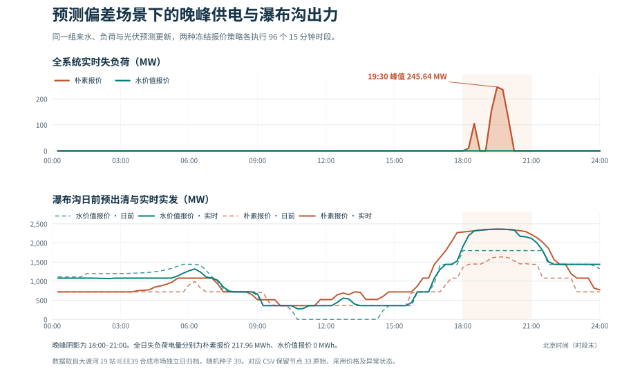
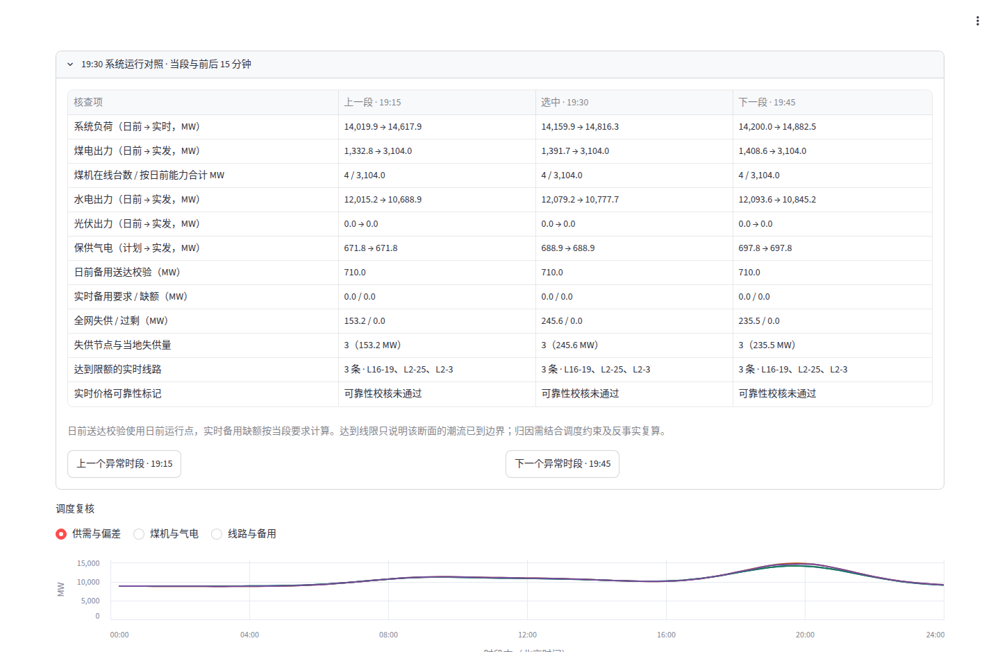

# 大渡河 19 站现货模拟结果

[打开预测偏差日完整报告](full-day/README.md) · [双策略 96 段对照表](forecast-comparison.csv) · [瀑布沟逐段量价与水量](pubugou-forecast-water-value.csv) · [启动交互程序](../../SICHUAN_V5.md)

## 三类场景，六个完整日

每个算例单独执行日前 96 点 SCUC/SCED 和 96 个实时首段。每个场景的两种报价使用相同的市场边界、公司预测、实时预测签发记录、种子 39 和模型版本。表内电量来自实时执行的 MW 乘以 0.25 小时。可靠性异常时保留物理量和原始节点价，暂停受影响时段及全天现金汇总。这里的收益口径为模拟组合，实际业主按站分列。

| 场景 | 报价 | 水电实发 GWh | 气电保供 GWh | 失负荷 MWh | 失负荷段数 | 最大缺口 MW | 组合现货毛收入 万元 | 含库存变动研究收益 万元 |
|---|---|---:|---:|---:|---:|---:|---:|---:|
| 丰水低负荷 | 水价值 | 191.18 | 3.65 | 0.00 | 0 | 0.00 | 1935.74 | 2925.35 |
| 丰水低负荷 | 朴素 | 190.59 | 3.65 | 0.00 | 0 | 0.00 | 1263.41 | 2654.88 |
| 枯水晚峰 | 水价值 | 195.63 | 13.44 | 0.00 | 0 | 0.00 | 4521.04 | 2420.17 |
| 枯水晚峰 | 朴素 | 194.21 | 13.44 | 93.98 | 4 | 118.94 | 暂停全天估值 | 暂停全天估值 |
| 预测偏差 | 水价值 | 184.42 | 7.98 | 0.00 | 0 | 0.00 | 2947.68 | 2783.59 |
| 预测偏差 | 朴素 | 180.49 | 7.98 | 217.96 | 6 | 245.64 | 暂停全天估值 | 暂停全天估值 |

**验收结论。** 六次计算全部完成。丰水两组、枯水水价值组均满足零失负荷要求。枯水朴素报价在节点 3 有 4 段失负荷，累计 93.98 MWh，未通过枯水基准。预测偏差为压力场景，两组的水账、网络平衡和计价处理均可复核，朴素报价有 6 段触发停价。按预设的场景验收条件，六组中五组通过。

## 公司计划、市场中标与实时实发

19 站共提交 115 个报价段。在同一场景内，两种策略使用相同事前预测、共享水量和内部计划；变化的是提交给市场的报价。公司内部计划只表达其在预期价格下愿意如何用水，市场还会考虑全网负荷、煤机组合、送出约束和各类运行边界。表内水电量均为 19 站合计的 GWh。

| 场景 | 公司内部计划 | 日前中标（水价值 / 朴素） | 实时实发（水价值 / 朴素） |
|---|---:|---:|---:|
| 丰水低负荷 | 427.95 | 191.55 / 191.54 | 191.18 / 190.59 |
| 枯水晚峰 | 349.18 | 196.08 / 196.29 | 195.63 / 194.21 |
| 预测偏差 | 403.80 | 176.55 / 177.11 | 184.42 / 180.49 |

例如，丰水低负荷水价值算例实时天然入水 174.537 百万 m³，末站出口 156.591 百万 m³，四库合计增加 69.816 百万 m³，18 段河道在途水量减少 51.870 百万 m³。两项库存变化相加，正好解释入水与出口的差额（表内数字取整）。六份完整日的日前和实时共 12 套流域水账，最大绝对残差低于 0.000005 m³。

[下载六组报价、三阶段电量和全流域水账](basin-six-cases.csv)

## 从哪里看起

| 要回答的问题 | 对应结果 |
|---|---|
| 公司为什么这样报价，各站实际中了多少？ | [冻结申报与有效分段](full-day/bids.csv)、[29 个资源台账与量价](full-day/resources.csv)、[水价值策略逐资源内部计划、日前与实时](full-day/water-value/dispatch.csv) |
| 丰枯、负荷和光伏如何改变开机与出力？ | [系统功率与能量](full-day/system.csv)。程序「实时出清与执行」可切换煤机启停、气电保供与日前/实时偏差。 |
| 上游放水多久到达，四库还剩多少水？ | [19 站水账](full-day/water-value/water.csv)。程序「全流域水情」可选择库站或河段，检查库存目标、过机流量、生态旁泄、弃水及跨日在途。 |
| 哪个节点缺电，哪些线路紧，备用能否送达？ | [节点负荷与价格](full-day/naive/nodes.csv)、[线路潮流](full-day/naive/flows.csv)、[支路方向和限额](full-day/network.csv)。基态与备用激活工况可在程序切换。 |
| 企业收到多少现金，留下的水值多少？ | [小时量价和收入](full-day/hourly.csv)、[库存与在途拆分](full-day/overview.csv)。企业真实成本、合同差价及补偿未完整建模，实际利润暂无可核算口径。 |

## 晚峰第 78 段为什么值得单看

北京时间 19:15–19:30，预测偏差场景的两种策略下，瀑布沟实发同为 2,361.01 MW。水价值策略全天满足负荷，朴素策略当段在节点 3 缺 245.64 MW。枯水晚峰同一时段，两策略煤机组合和气电计划也相同；朴素策略水电少发 538.72 MW，在线煤机多发 419.79 MW，尚差 118.94 MW。由单站实发或库存不能单独推出失供成因，应结合其他站水量、在途、可用出力与断面观察。

## 用同一时段核对四个岗位的结果

在完整日归档中选择 **预测偏差、朴素报价、瀑布沟、第 78 段（19:15–19:30）**。在「查看厂站」中输入站名即可定位。切换两种报价时会保留当前厂站和时段，打开首小时档案时会停在已执行的末段。

| 岗位 | 先看什么 | 这份档案能核到什么 |
|---|---|---|
| 电站报价员 | 对应分段申报价、日前中标、实时计量 | 瀑布沟目标段价为 80 元/MWh，日前中标 1,630.53 MW，实时实发 2,361.01 MW。按出力定位的分段价格与节点结算价格分别列示。 |
| 电网调度员 | 缺口节点、相邻时段、煤水气实发与线路余度 | 节点 3 缺 245.64 MW；四台煤机合计已到 3,104 MW。该段 L16-19、L2-25、L2-3 达到限额。判断各条线路对缺口的贡献还需反事实试算。 |
| 水库调度员 | 瀑布沟来水、过机与非过机下泄、下游河道队列 | 瀑布沟过机 1,698.75、生态旁泄 7.38、弃水 452.13 m³/s，总下泄 2,158.26 m³/s。经 5 个时段，这 194.24 万 m³ 于 20:30–20:45 计入深溪沟上游到水。 |
| 结算复核人员 | 节点原始价、采用价、已核价现金和待核电量 | 朴素策略的 90 个可计价时段合计 164,530.10 MWh、1,213.51 万元。另有 15,955.11 MWh 待核。该日总收入和含水库存价值的收益比较均暂停。 |

若查看 **预测偏差、水价值报价** 的同一站、同一时段，可核对本站实发同为 2,361.01 MW，而全网失供降为零。应同时查看系统水电、煤电和其他站的水量空间分布。

## 上一版浏览器操作记录

[报价员的分段申报与当段成交](screens/company.png) · [电网调度三时段对照](screens/dispatch.png) · [瀑布沟至深溪沟的在途与到水](screens/water.png) · [手机上核对组合现金与两种报价](screens/settlement-mobile.png)

下图是预测偏差日朴素报价的实际页面。中列为北京时间 19:15–19:30，左右列为相邻两个已执行时段。上方表格保留原始调度量，末行标出计价可靠性。

[查看桌面和手机 Chrome 操作记录](https://github.com/stardustwlshen/spot_market_ieee39/actions/runs/45999182965)

## 枯水晚峰的单因素复算

种子 39、朴素报价。控制组和两个试验组均重新优化公司申报、执行日前 SCUC/SCED，再滚动执行 96 个首段。三次冻结报价摘要与随库控制档案一致，日前逐机出力逐段相符（误差小于 0.0001 MW），气电计划与实发均为 13,436.90 MWh。

| 试验条件 | 实时失负荷 MWh | 缺口段数 | 最大缺口 MW |
|---|---:|---:|---:|
| 默认，2 小时窗口、原通道 | 93.98 | 4 | 118.94 |
| 仅提高 T25–37 通道限额 20% | 93.98 | 4 | 118.94 |
| 仅将实时前瞻窗口从 2 小时增至 4 小时 | 12.64 | 3 | 27.24 |

该日扩容 T25–37 对上述缺口没有改善。延长窗口后少失供 81.34 MWh（86.55%），仍有 3 个时段未满足全部负荷。窗口变化会改变实时可见的预测时域；首段执行、冻结报价与日前机组计划仍可核对。仅据此算例无法认定其他日的最优窗口，也不能定位剩余缺口的唯一原因。

这三次 Linux 复算与随库原档的逐次实时签发摘要未完全复现。默认控制组的失负荷总量、段数和峰值均复现。本表单列复算物理量，原六组策略配对继续执行同版本、同边界和同签发的检查。三个试验均有可靠性松弛，全天现金继续留空。

[同平台控制组计算记录](https://github.com/stardustwlshen/spot_market_ieee39/actions/runs/45998920426/job/140505288508) · [通道试验](https://github.com/stardustwlshen/spot_market_ieee39/actions/runs/45998836891/job/140505010424) · [窗口试验](https://github.com/stardustwlshen/spot_market_ieee39/actions/runs/45998836891/job/140505010420)

## 结果边界与复核

19 站统一报价属于研究用模拟组合。四川 V5.0 征求意见稿提供规则基线，IEEE39 送出网络、来水预测、报价、预测裕度、计量和电价均对应合成场景。日前不计结算收入。水价值策略和朴素策略的库存估值使用同一事前口径。

[查看完整日复算说明](full-day/README.md) · [查看瀑布沟节点价 96 点](pubugou-forecast-water-value.csv)
