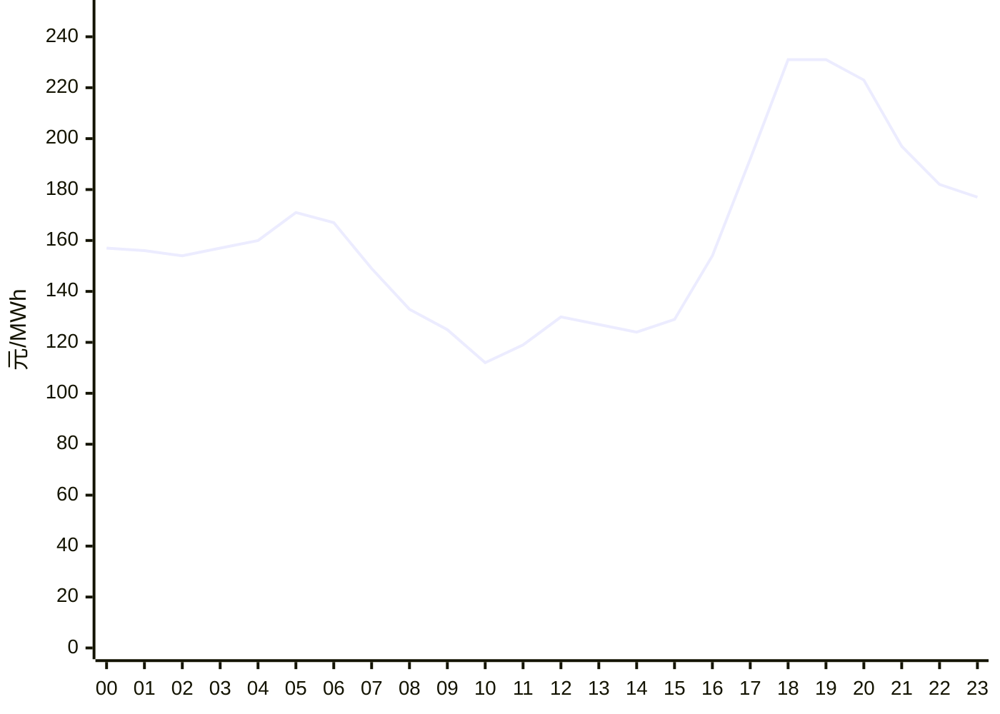

# 大渡河 19 站运行结果

[四川程序启动说明](../../SICHUAN_V5.md) · [瀑布沟 96 点运行数据](./pubugou-forecast-water-value.csv) · [完整示例归档](../../runs_sichuan_v5_consultation/dadu19/dadu19_20261127T094442Z_9a78ae68318c)

## 已实际执行的 96 个实时段

IEEE39 共 39 个节点、46 条支路。系统包括 22,056 MW 水电、3,200 MW 煤电、1,200 MW 计划保供气电和 8,820 MW 普通集中式光伏。一日为 96 个 15 分钟。种子为 39，默认送出限额、气电计划和水价值倍率均为 1。公司在日前冻结 19 站申报。日前只作参考，表中电能量收入来自模拟实时计量与对应节点有效价格。

下表取自第一轮完整日归档，便于单独复核。后续版本调整了供给能力校验与预测裕度，比较策略时请使用同一轮、同一场景的两组结果。

| 丰水低负荷 | 水价值报价 | 朴素报价 |
|---|---:|---:|
| 实时电能量收入（万元） | 1,935.74 | 1,263.41 |
| 计入库水及在途水价值变化后的研究收益（万元） | 2,925.35 | 2,654.88 |
| 各站弃水量之和（百万 m³） | 803.81 | 394.35 |
| 气电计划执行（MWh） | 3,647.38 | 3,647.38 |
| 光伏弃电（MWh） | 0.00 | 23.07 |
| 全日最大失负荷（MW） | 0.00 | 0.00 |

弃水逐站合计，同一股水下行后仍可能被下游利用。研究收益中的库存部分按同一套事前水价值计入变动。真实业主与模拟报价组合在数据中分别登记。

## 在显示界面核对枯水日

选“枯水晚峰 → 水价值报价 → 实时实发 → 瀑布沟”。在完整日回放中，首个 15 分钟瀑布沟实发 1,440 MW，较日前偏差 0 MW，实时节点价 241.25 元/MWh。该日 19 站组合实时电能量收入为 4,521.04 万元，气电按计划执行 13,436.90 MWh，全天最大失负荷为零。

## 预测偏差下的可靠性

第一轮晚峰第 79 段的全网失负荷，两种策略分别为 122.1 MW 和 626.5 MW。程序会保留物理执行和原始价格，标记失负荷并暂停相应估值。

第二轮采用 D-1 负荷峰值与合成误差分布，在日前预留 710 MW 预测裕度，实时允许动用。双策略均完成 96 段。水价值策略全天零失负荷，朴素策略有 6 段失负荷，最大为 245.64 MW。该轮使用系统总量裕度。网络能否在负荷同步上升时送出备用，需要核对备用激活后的线路潮流。

第三轮在日前显式校验 710 MW 负荷增量同时出现在各节点时，备用激活后的 46 条线路潮流。两策略采用与第二轮相同的实时输入，并各完成 96 段。

| 预测偏差，含备用可送达校验 | 水价值报价 | 朴素报价 |
|---|---:|---:|
| 实时电能量收入（万元） | 2,947.68 | 暂停全天估值 |
| 当日失负荷电量（MWh） | 0 | 217.96 |
| 失负荷时段数 | 0 | 6 |
| 最大失负荷（MW） | 0 | 245.64 |

朴素策略出现缺口的位置是节点 3。日前备用激活校核能审查调度方案的传输条件；全天运行仍需考虑滚动水量、来水、跨站传播时滞和实际可用出力。

以上结果仅用于比较合成 IEEE39 场景。装机、可用容量、冻结报价、实时中标与气电计划可在程序中分别查看。

## 瀑布沟逐小时实时节点价

预测偏差日，水价值报价。每小时以瀑布沟实际电量加权，图中显示整数，96 点表保留原始时段精度。横轴为北京时间小时。

